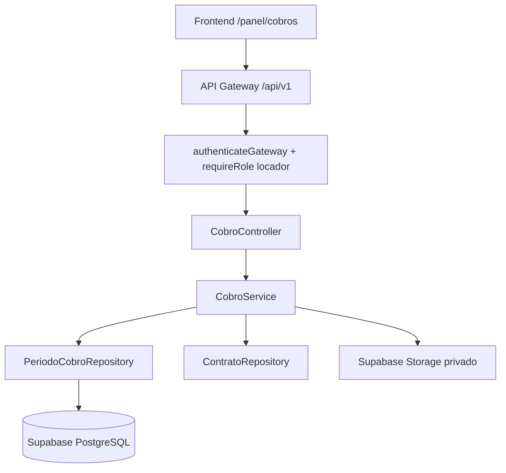

# Plan de implementación: US-08 Registrar cobro

## Objetivo y alcance

Implementar el registro autenticado de cobros recibidos fuera de RentAR por parte del locador dueño de la propiedad. El flujo debe registrar únicamente el saldo total de períodos pendientes o vencidos, conservar el historial y dejar el período en estado pagado.

La implementación seguirá la arquitectura actual de `apps/api`: router versionado, middleware de autenticación y rol, controller, service, repository, DTOs locales, migraciones Supabase y documentación OpenAPI. El frontend consumirá los endpoints desde `apps/web` mediante `services/`.

El alcance de esta US incluye:

- consulta mínima de períodos cobrables del locador para seleccionar propiedad, locatario y período;
- registro de un cobro manual;
- validación de pertenencia del contrato al locador y de las reglas del período;
- historial de quién registró el cobro y cuándo;
- comprobante adjunto opcional.

La consulta completa de cobros pertenece a US-09 y la emisión/renderizado del comprobante PDF pertenece a US-10. US-08 debe persistir el identificador y número correlativo del comprobante para que US-10 pueda consultarlo, pero no debe generar ni almacenar el PDF. El cálculo detallado de intereses por mora pertenece a US-12; US-08 debe consumir una función de dominio compartida y no duplicar la fórmula.

## 1. Reglas de negocio

### Acceso y autorización

1. Todas las rutas requieren `Authorization: Bearer` mediante `authenticateGateway`.
2. Todas las operaciones requieren rol `locador` mediante `requireRole('locador')`.
3. La propiedad, el contrato y el período se autorizan por la relación `inmueble.id_locador = req.user.id`. No se acepta un `id_locador` enviado por el cliente.
4. Un locatario, un garante o un locador distinto deben recibir 403 en las operaciones generales y 404 genérico en los recursos cuya existencia no deba revelarse, según la convención vigente del backend.
5. Solo se puede registrar un cobro sobre un contrato vigente (`estado_contrato = 2`). Contratos en borrador, pendientes de firma, finalizados o de oferta no son cobrables.

### Períodos cobrables

1. Solo se pueden registrar períodos `pendiente` o `vencido`.
2. No se puede registrar un período futuro ni uno `pagado`.
3. El período se identifica por contrato y mes calendario (`YYYY-MM`), nunca por un monto calculado por el cliente. La clave única debe impedir más de un período por contrato y mes.
4. La consulta debe incluir períodos de meses anteriores que sigan pendientes o vencidos.
5. El estado `vencido` se determina comparando la fecha actual con `fecha_vencimiento`. La fecha actual debe inyectarse en el service para que las pruebas sean deterministas.
6. El cobro de US-08 debe cubrir exactamente el saldo exigible del período. Al registrarlo, el período pasa a `pagado` dentro de la misma transacción. No se crea un estado `parcial` ni se permite registrar un monto menor.

### Monto y fecha

1. El monto exigible del período es el alquiler base del contrato más los intereses por mora. Las expensas no forman parte del monto que se registra en US-08.
2. La mora se calcula en servidor de forma lineal: por cada día posterior a los días de gracia se suma `monto_base_alquiler * (interes_por_dia / 100)`. Ejemplo: base 100.000 e interés diario 3%: un día = 103.000, dos días = 106.000. No se aplica interés compuesto.
3. Los días de atraso se cuentan desde el día posterior al vencimiento, pero el recargo comienza solo una vez superados los días de gracia.
4. El monto efectivo del cobro debe coincidir exactamente con el saldo exigible. Si es menor o mayor, responde 400.
5. La fecha del cobro no puede ser futura ni anterior a `fecha_inicio_contrato`.
6. La fecha por defecto del formulario es la fecha actual, pero la API valida siempre el valor recibido.
7. Los montos se almacenan en `NUMERIC(12,2)` para conservar precisión monetaria, aunque la US valide importes enteros.

### Medio, comprobante y auditoría

1. Los medios manuales permitidos son: `transferencia`, `efectivo`, `cheque`, `mercadopago_externo` y `otro`.
2. Si el medio es `otro`, la nota es obligatoria y admite hasta 200 caracteres.
3. El comprobante adjunto es opcional; si existe, debe ser PDF, JPG o PNG y no superar 5 MB.
4. Un cobro manual se registra como externo; nunca debe aparecer como un pago procesado por RentAR.
5. Un cobro registrado no se edita ni se elimina.
6. Los timestamps los asigna el servidor con `now()`. El cliente no puede enviar quién registró.

## 2. Estado actual de Supabase

La base actual ya tiene los datos necesarios del contrato, pero no tiene persistencia de cobros:

- `contrato`: monto, expensas, interés diario, días de gracia, día de vencimiento (`dias_para_vencimiento`), fechas de vigencia y estado.
- `medio_pago` y `medio_pago_x_contrato`: medios aceptados por contrato.
- `contrato_x_usuario`: locador, locatario y firmantes.
- `ajuste_contrato`: historial de ajustes aplicados y monto nuevo.
- `contratos-pdf`: bucket privado para contratos.
- No existen tablas `periodo_cobro`, `cobro`, `cobro_comprobante` ni un bucket privado para comprobantes adjuntos.
- No existe todavía un registro de pagos por fuera de la plataforma.

La migración de US-27 define `dias_para_vencimiento` como día del mes entre 1 y 28. US-08 debe reutilizar esa regla. `interes_por_dia` y `dias_gracia` son condiciones inmutables del contrato y se usan para calcular la mora lineal.

El contrato no puede modificar sus condiciones mientras esté vigente entre locador y locatario. La migración actual bloquea cambios después de una conformidad, pero US-08 requiere además una restricción/trigger que impida modificar monto, expensas, índice, frecuencia, depósito, vencimiento, interés, días de gracia, fechas y partes cuando el contrato vigente (`estado = 2`) ya tenga su relación locador-locatario. Los ajustes futuros deben resolverse como eventos separados y no mutar silenciosamente el contrato base.

## 3. Modelo de datos propuesto

### Tabla `periodo_cobro`

Crear una migración versionada, por ejemplo `YYYYMMDD000000_us08_registrar_cobro.sql`:

```sql
CREATE TABLE public.periodo_cobro (
  id BIGSERIAL PRIMARY KEY,
  id_contrato INTEGER NOT NULL REFERENCES public.contrato(id) ON DELETE RESTRICT,
  periodo CHAR(7) NOT NULL,
  fecha_inicio DATE NOT NULL,
  fecha_fin DATE NOT NULL,
  fecha_disponible_monto DATE NOT NULL,
  fecha_vencimiento DATE NOT NULL,
  monto_base_alquiler NUMERIC(12,2) NOT NULL CHECK (monto_base_alquiler > 0),
  expensas_snapshot NUMERIC(12,2) NOT NULL DEFAULT 0 CHECK (expensas_snapshot >= 0),
  interes_diario_pct NUMERIC(6,2) NOT NULL DEFAULT 0 CHECK (interes_diario_pct >= 0),
  dias_gracia SMALLINT NOT NULL DEFAULT 0 CHECK (dias_gracia >= 0),
  estado VARCHAR(20) NOT NULL DEFAULT 'pendiente'
    CHECK (estado IN ('pendiente', 'vencido', 'pagado')),
  created_at TIMESTAMPTZ NOT NULL DEFAULT now(),
  UNIQUE (id_contrato, periodo),
  CHECK (periodo ~ '^[0-9]{4}-(0[1-9]|1[0-2])$'),
  CHECK (fecha_inicio = make_date(left(periodo, 4)::integer, right(periodo, 2)::integer, 1)),
  CHECK (fecha_fin = (date_trunc('month', fecha_inicio::timestamp) + interval '1 month - 1 day')::date)
);
```

Decisiones:

- `periodo` es la clave funcional `YYYY-MM`; `fecha_inicio` y `fecha_fin` son siempre el primer y último día del mes calendario.
- Se guarda un snapshot de alquiler base, interés diario y días de gracia para que el historial no cambie si luego cambia el contrato.
- `expensas_snapshot` puede mostrarse en consultas posteriores, pero no se copia al monto exigible ni al cobro de US-08.
- `fecha_vencimiento` se persiste porque el vencimiento es un hecho del período y no debe cambiar retrospectivamente.
- `estado` puede recalcularse desde los cobros, pero se persiste para listar eficientemente; toda escritura debe actualizarlo dentro de la misma transacción.
- US-08 solo necesita `pendiente`, `vencido` y `pagado`.
- Crear índice por `(id_contrato, fecha_inicio DESC)` y por `(estado, fecha_vencimiento)`.

### Tabla `cobro`

```sql
CREATE TABLE public.cobro (
  id BIGSERIAL PRIMARY KEY,
  id_periodo BIGINT NOT NULL REFERENCES public.periodo_cobro(id) ON DELETE RESTRICT,
  id_usuario_registro INTEGER NOT NULL REFERENCES public.usuario(id) ON DELETE RESTRICT,
  monto NUMERIC(12,2) NOT NULL CHECK (monto > 0),
  fecha_cobro DATE NOT NULL,
  medio VARCHAR(30) NOT NULL
    CHECK (medio IN ('transferencia', 'efectivo', 'cheque', 'mercadopago_externo', 'otro')),
  nota VARCHAR(200),
  comprobante_storage_path TEXT,
  numero_comprobante VARCHAR(20),
  fecha_emision TIMESTAMPTZ NOT NULL DEFAULT now(),
  created_at TIMESTAMPTZ NOT NULL DEFAULT now(),
  CONSTRAINT cobro_otro_nota_check CHECK (medio <> 'otro' OR char_length(trim(nota)) > 0)
);
```

Decisiones:

- Los cobros son inmutables: US-08 no permite editarlos ni eliminarlos.
- `id_usuario_registro` permite mostrar quién cargó el cobro y mantener el historial.
- `comprobante_storage_path` es la ruta del comprobante adjunto del locador, no la del PDF de US-10. El límite del archivo adjunto es 5 MB.
- `numero_comprobante` y `fecha_emision` permiten que US-10 genere el PDF bajo demanda sin guardar el PDF en Storage. El número debe asignarse en la transacción de registro con una secuencia anual sin huecos.
- No se guarda una columna `saldo` en el cobro; US-08 valida que el cobro cubra el exigible del período. La suma histórica y los estados adicionales quedan para US-09/US-10.
- Crear índices por `id_periodo`, `id_usuario_registro` y `created_at`.

### Bucket privado

Crear el bucket privado `comprobantes-cobro` únicamente para el comprobante que el locador adjunta al registrar el cobro. La API debe subir y leer esos archivos con la clave de servicio, validando extensión, MIME y tamaño máximo de 5 MB antes de persistir la ruta. El acceso del frontend debe ser mediante una URL firmada de corta duración y solo después de autorizar al usuario correspondiente.

El PDF emitido por US-10 no se guarda en ningún bucket: se genera bajo demanda cada vez que se consulta o descarga. No mezclarlo con el comprobante opcional que adjunta el locador.

## 4. Contrato HTTP propuesto

### `GET /api/v1/cobros-locador`

Lista períodos de contratos del locador autenticado.

Query params opcionales:

| Parámetro | Tipo | Valores | Uso |
|---|---|---|---|
| `estado` | string | `pendiente`, `vencido` | Filtra el estado cobrable del período. |
| `id_inmueble` | integer | positivo | Limita a una propiedad propia. |
| `id_contrato` | integer | positivo | Limita a un contrato propio. |
| `desde` / `hasta` | date | `YYYY-MM-DD` | Filtra períodos por fecha de inicio. |
| `page` / `limit` | integer | positivos | Paginación del listado. |

Sin filtros de propiedad, el endpoint devuelve solo contratos vigentes del locador para el botón general “Registrar cobro”. Para consultar historial de contratos finalizados, se podrá ampliar el filtro cuando la pantalla de Cobros lo requiera, pero no debe ofrecer períodos cobrables de contratos no vigentes.

La respuesta debe incluir propiedad, locatario, contrato, período, saldo exigible, fecha de vencimiento y estado. El cálculo de mora debe venir de una función común de dominio. El detalle completo del período pertenece a US-09.

### `POST /api/v1/cobros-locador`

Registra un cobro manual. Body propuesto:

```json
{
  "id_periodo": 123,
  "fecha_cobro": "2026-11-02",
  "medio": "transferencia",
  "nota": null,
  "comprobante": {
    "archivo": "multipart/form-data",
    "mime_type": "application/pdf",
    "size_bytes": 123456
  }
}
```

No aceptar desde el cliente `id_usuario_registro`, estado del período, saldo, interés, monto, ruta de Storage ni contrato. El service debe recibir el archivo mediante multipart o un flujo de carga controlado por la API, validar MIME/tamaño, reconsultar el período con lock transaccional, calcular el saldo y validar todas las reglas antes de insertar. El monto que se persiste es el saldo calculado por el servidor.

Respuestas:

- `201`: cobro registrado y período actualizado a `pagado`.
- `400`: datos inválidos, monto, fecha, medio, nota o archivo.
- `403`: contrato o propiedad no pertenece al locador.
- `409`: período futuro, pagado, contrato no vigente, período sin saldo cobrable o inconsistencia transaccional.

La consulta detallada del período, la anulación de cobros, la descarga del comprobante y la emisión del PDF se implementan en US-09/US-10.

## 5. DTOs

Crear DTOs propios en `apps/api/src/dtos/cobro.dto.ts` y exportarlos desde `apps/api/src/dtos/index.ts`. No reutilizar los DTOs de contratos de US-27 como respuesta completa porque el dominio de Cobros necesita saldo, períodos y auditoría.

Tipos sugeridos:

- `EstadoPeriodoCobroDTO`: `pendiente | vencido | pagado` para el alcance de US-08.
- `MedioCobroManualDTO`: `transferencia | efectivo | cheque | mercadopago_externo | otro`.
- `FiltrosCobrosLocadorDTO`.
- `PeriodoCobroItemDTO`.
- `RegistrarCobroDTO`.
- `CobroDTO`.

Los DTOs deben representar como `null` lo que todavía no exista. `RegistrarCobroDTO` solo debe aceptar `id_periodo`, `fecha_cobro`, `medio`, `nota` y el comprobante opcional. No debe aceptar el estado, el saldo, el monto calculado, el usuario que registra ni el contrato derivado del cliente.

## 6. Arquitectura y componentes



### Repository

Crear `apps/api/src/repositories/cobro.repository.ts` o separar `periodo-cobro.repository.ts` y `cobro.repository.ts` si las consultas crecen. El repository debe ofrecer operaciones transaccionales mediante una función SQL/RPC cuando involucren lock, inserción y recalculo:

- `findPeriodosByLocadorId(locadorId, filtros)`;
- `findPeriodosCobrablesByLocadorId(locadorId, filtros)`;
- `createCobroManual(input, locadorId)`.

La consulta de autorización debe partir de `periodo_cobro -> contrato -> inmueble.id_locador`. Nunca confiar solo en el ID que llega por URL.

### Service

Crear `apps/api/src/services/cobro.service.ts` con reloj inyectable y una utilidad común para:

- determinar estado por vencimiento;
- calcular mora lineal según US-12: `monto_base_alquiler * (interes_diario_pct / 100) * dias_con_interes`;
- calcular `dias_con_interes` como los días posteriores al vencimiento menos los días de gracia, con mínimo cero;
- calcular el saldo total exigible sin sumar expensas;
- validar fecha, medio, nota y comprobante;
- asegurar que el contrato esté vigente;
- traducir errores de dominio a códigos HTTP esperados.

La operación de alta debe ser atómica. Dos requests concurrentes no pueden registrar dos veces el mismo período; por eso el período debe bloquearse (`SELECT ... FOR UPDATE`) o la RPC debe encapsular el cálculo, la inserción del cobro y el cambio a `pagado`.

### Controller y rutas

Crear `apps/api/src/controllers/cobro.controller.ts` y `apps/api/src/routes/v1/cobros-locador.routes.ts`. Montar el router en `apps/api/src/routes/v1/index.ts` como `/cobros-locador`.

El controller solo parsea parámetros, llama al service y arma el sobre `ApiResponse`. No debe consultar Supabase ni calcular saldos.

### Frontend

Agregar services en `apps/web/src/services/cobros.service.ts` y adaptar los DTOs de API a tipos de vista. La pantalla y el modal de `/panel/cobros` quedan fuera del primer cambio de backend, pero deben consumir:

- listado de períodos cobrables;
- alta manual con saldo calculado por el backend.

## 7. Migración y compatibilidad

1. Crear las tablas e índices con una migración nueva, sin modificar destructivamente `contrato` ni `contrato_x_usuario`.
2. No crear automáticamente períodos históricos sin una regla acordada: se necesita definir desde qué fecha comenzó cada contrato y qué períodos pendientes/vencidos deben poder cobrarse.
3. Para contratos vigentes existentes, preparar un backfill revisable que genere períodos desde `fecha_inicio_contrato` hasta el período actual, usando `monto_alquiler`, `expensas`, `interes_por_dia` y `dias_para_vencimiento` vigentes. No inventar intereses ni pagos históricos.
4. Si no se puede verificar el historial, dejar esos períodos como pendientes y documentar el backfill como decisión del PO/DBA antes de producción. No crear cobros históricos ni estados parciales inventados.
5. Si un contrato no tiene `dias_para_vencimiento`, no crear períodos cobrables automáticamente o marcar la fecha de vencimiento como `null` hasta completar la condición; no asumir el día 10 salvo que el contrato haya sido creado por `iniciar_contrato` con ese valor.
6. Los períodos se generan al activar el contrato, dentro de la misma transacción que cambia el contrato a vigente. Se crea un período por cada mes calendario desde el mes de inicio hasta el mes de fin, usando el primer y último día de cada mes y la fecha de vencimiento configurada, ajustada al rango del período si fuera necesario.
7. No se usará un cron ni generación bajo demanda para crear períodos de un contrato recién activado: la activación debe dejar la colección completa de períodos lista para consultar.

### Política de backfill propuesta

- No inventar cobros históricos, intereses ni estados pagados.
- Para cada contrato que ya esté vigente, crear períodos desde el mes de `fecha_inicio_contrato` hasta el mes actual, o hasta el mes de `fecha_fin_contrato` si ya finalizó.
- Usar como snapshot el monto de alquiler, `interes_por_dia`, `dias_gracia` y `dias_para_vencimiento` actualmente persistidos. Las expensas se guardan solo para consulta histórica futura, nunca se suman al cobro de US-08.
- Marcar todos los períodos sin evidencia de pago como `pendiente` o `vencido` según su fecha de vencimiento. No marcarlos como `pagado` por inferencia.
- Excluir ofertas, borradores y contratos sin fecha de inicio. Reportarlos para resolución manual antes de habilitar Cobros.
- Ejecutar el backfill en una migración o script idempotente, con una tabla/log de resultados y revisión de duplicados por `UNIQUE (id_contrato, periodo)`.
- Los contratos vigentes con condiciones modificadas históricamente no pueden reconstruirse con certeza; conservar el snapshot actual y dejar esa limitación documentada.

## 8. Swagger / OpenAPI

Documentar en `apps/api/src/routes/v1/cobros-locador.routes.ts`:

- `GET /api/v1/cobros-locador` con seguridad `SupabaseBearerAuth`, filtros, paginación y esquema de respuesta.
- `POST /api/v1/cobros-locador` con body, campos obligatorios y respuestas 201/400/403/409.

Usar el sobre real `ApiResponse<T>` y no documentar variables o estados que el endpoint no pueda devolver. El esquema debe diferenciar `monto_exigible` y `saldo`; en US-08 ambos deben coincidir porque no se aceptan pagos parciales. El response de `POST` debe devolver el `id_cobro`, `numero_comprobante` y los datos del período necesarios para que US-10 consulte el comprobante.

## 9. Pruebas unitarias

La base de pruebas API existente no debe ser la única cobertura: según la guía del repositorio, esos tests escriben en la base y usan autenticación antigua. Agregar unit tests con repositories falsos y reloj controlado.

Casos mínimos del service:

- Usuario sin sesión: 401 en middleware.
- Locatario o garante intentando registrar: 403.
- Locador distinto de la propiedad: 403/404 según el endpoint.
- Contrato pendiente, borrador, finalizado u oferta: rechazo.
- Período pendiente y vencido: aceptación.
- Período futuro o pagado: rechazo.
- Contrato sin saldo cobrable: rechazo.
- Saldo calculado correctamente, con y sin mora.
- El cliente no puede enviar un monto parcial ni alterar el saldo calculado.
- El cobro completo cambia el período a pagado.
- Fecha futura o anterior al inicio del contrato: rechazo.
- Medio `otro` sin nota: rechazo; nota de más de 200 caracteres: rechazo.
- Comprobante ausente: aceptación; PDF/JPG/PNG válido de hasta 5 MB: aceptación; MIME/extensión inválido o mayor a 5 MB: rechazo.
- Edición o eliminación del cobro: no disponible.
- Concurrencia: dos requests no pueden registrar dos cobros para el mismo período.
- Contrato sin `dias_para_vencimiento`: no generar fecha inventada.

Casos de controller:

- Query de estado inválido responde 400 si se agrega filtro de estado.
- Lista vacía responde 200 con arreglo vacío.
- Detalle ajeno e inexistente no revela información.
- Swagger refleja rutas y estados reales.

## 10. Archivos previstos

- `supabase/migrations/YYYYMMDD000000_us08_registrar_cobro.sql`.
- Posible migración de backfill de períodos, separada y revisable.
- `apps/api/src/dtos/cobro.dto.ts` y `apps/api/src/dtos/index.ts`.
- `apps/api/src/repositories/cobro.repository.ts` y, si conviene, `periodo-cobro.repository.ts`.
- `apps/api/src/services/cobro.service.ts`.
- Función/RPC de activación de contrato que genere todos los períodos calendario de forma transaccional.
- `apps/api/src/controllers/cobro.controller.ts`.
- `apps/api/src/routes/v1/cobros-locador.routes.ts` y `apps/api/src/routes/v1/index.ts`.
- `apps/api/src/config/swagger.ts` solo si se agregan esquemas globales.
- `apps/api/tests/unit/cobro.service.test.ts` y tests de controller.
- `apps/web/src/services/cobros.service.ts` y tipos/adaptadores de vista.
- `docs/api-endpoints.md` y `docs/HANDOFF-BACKEND.md`.
- Bucket privado `comprobantes-cobro` en Supabase Storage para adjuntos de hasta 5 MB. No crear bucket para el PDF de US-10.
- Trigger o función SQL de inmutabilidad de contratos vigentes, integrado en la migración de US-08 o en una migración de contratos compartida.

## 11. Secuencia de implementación

1. Acordar con PO/DBA la regla exacta de períodos, fecha de disponibilidad del monto, tratamiento de expensas, mora y backfill histórico.
2. Implementar la migración de `periodo_cobro`, `cobro`, índices, constraints, bucket privado para adjuntos y trigger de inmutabilidad de contratos vigentes.
3. Implementar el cálculo de saldo/estado y la función de intereses lineales de US-12 con reloj inyectable.
4. Implementar la activación del contrato para generar todos sus períodos calendario y el repository/RPC para listar y registrar el saldo total sin duplicar cobros bajo concurrencia.
5. Definir DTOs, service y controller con autorización por propietario.
6. Montar las rutas y documentarlas en Swagger.
7. Agregar unit tests con repositories falsos y casos de autorización, saldo, mora y registro de pago total.
8. Implementar el service del frontend y luego la pantalla/modales de Cobros.
9. Coordinar con US-09 la consulta detallada del período y con US-10 la emisión del comprobante, sin mezclar el PDF emitido con el archivo adjunto del locador.
10. Validar manualmente con contratos vigentes, períodos históricos, registro completo y acceso cruzado.

## 12. Criterio de cierre

US-08 queda lista cuando:

- solo el locador dueño puede registrar cobros;
- el backend genera y valida los períodos sin confiar en datos calculados por el cliente;
- el cobro registrado cubre el saldo total y el período pasa a pagado;
- la mora usa la fórmula única de US-12;
- el cobro conserva auditoría y no puede editarse ni eliminarse desde US-08;
- el comprobante adjunto opcional queda en almacenamiento privado, con máximo 5 MB;
- US-10 puede generar el PDF bajo demanda usando `id_cobro`/`numero_comprobante`, sin leer un PDF almacenado;
- DTOs, Swagger, tests y documentación reflejan el mismo contrato;
- los períodos históricos y contratos sin fecha de vencimiento quedan tratados explícitamente, sin datos inventados.

## 13. Dependencias y decisiones pendientes

Antes de implementar la migración deben confirmarse:

- cómo se representará en US-09 el historial de cobros futuros, pagos parciales y anulaciones, que no forman parte de US-08;
- nombre definitivo del bucket y retención de adjuntos;
- MIME real aceptado por Storage, además de la validación de API de 5 MB.

## 14. Consumo por US-10

US-08 no debe renderizar ni almacenar el PDF. Al registrar el cobro, la misma transacción asigna y persiste `numero_comprobante` con formato `RC-AAAA-NNNN`, junto con `fecha_emision`, `id_cobro`, `id_periodo`, monto, medio y fecha de pago. La correlatividad anual debe resolverse con una secuencia/contador transaccional, sin generar números en el frontend.

US-10 consulta el cobro autorizado por el locador o el locatario del contrato y construye el comprobante con esos datos, el período calendario y el desglose de alquiler e intereses. El endpoint de comprobante genera el PDF en cada consulta/descarga y lo devuelve como respuesta o stream; no guarda el PDF en `Storage`. El archivo adjunto que el locador cargó en US-08 es independiente y sí puede permanecer en el bucket privado `comprobantes-cobro`.
