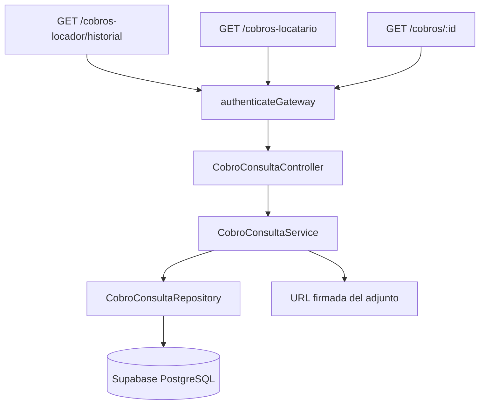

# Plan de implementación: US-09 Consultar cobro

## Objetivo y alcance

Implementar únicamente el backend de la consulta de cobros y períodos de alquiler. La US debe permitir que:

- el locador consulte los períodos de sus propiedades y el detalle de cada período;
- el locatario consulte los pagos de los contratos en los que participa como locatario principal;
- ambos consulten el mismo detalle cuando tienen autorización sobre el período;
- el frontend reciba indicadores, filtros, orden, cargos, saldos, historial y enlaces autorizados al comprobante adjunto;
- el frontend pueda enlazar al comprobante de pago de US-10.

La implementación seguirá la arquitectura actual de `apps/api`: autenticación, controllers, services, repositories, DTOs locales, Supabase y documentación OpenAPI. No se implementan en esta US las pantallas de `/panel/cobros` ni `/panel/pagos`.

US-09 es de solo lectura. No registra, edita ni elimina cobros. El registro manual, la transición del período a `pagado` y la asignación del número `RC-AAAA-NNNN` pertenecen a US-08. La generación del comprobante PDF pertenece a US-10.

## 1. Reglas de negocio

### Acceso y autorización

1. Todas las rutas requieren `authenticateGateway`.
2. Las rutas del locador autorizan únicamente por `inmueble.id_locador = usuario autenticado`.
3. Las rutas del locatario autorizan únicamente por `contrato_x_usuario.id_usuario = usuario autenticado` y `tipo_firmante = 2`.
4. La consulta del detalle debe aplicar la autorización dentro de la misma consulta que busca el período. No se debe consultar primero por ID y autorizar después.
5. Un período inexistente o ajeno debe devolver `404` con el mensaje exacto `No encontramos este cobro`, sin revelar si el recurso existe.
6. Un garante, otro locatario, un locador de otra propiedad y un usuario sin relación no pueden ver el período, los cobros, el historial ni el adjunto.
7. Un usuario con roles locador y locatario puede acceder por ambos caminos, pero cada respuesta debe limitarse a la relación concreta que justifica el acceso.

### Períodos y cobros

1. Un período se identifica por contrato y mes calendario `YYYY-MM`.
2. Los estados de esta versión son `pendiente`, `vencido` y `pagado`.
3. El estado visual `vencido` se determina comparando `fecha_vencimiento` con la fecha actual inyectada en el service. No se modifica la base solo por consultar.
4. Un período pagado tiene un único cobro en el alcance actual de US-08. No se agregan pagos parciales ni anulaciones en US-09.
5. El saldo se calcula en servidor:
   - período pendiente o vencido: monto exigible menos cobros registrados;
   - período pagado: cero;
   - cobrado: suma de cobros persistidos.
6. El monto exigible incluye alquiler base más mora lineal, pero excluye expensas.
7. Los intereses se calculan con el snapshot del período: `monto_base_alquiler * (interes_diario_pct / 100) * dias_con_interes`.
8. El desglose de intereses debe exponer días de mora y días alcanzados por interés cuando corresponda.
9. No se deben aceptar montos, estados, saldos ni IDs de usuario enviados por el cliente para alterar la respuesta.

### Orden y filtros del locador

1. El listado del locador muestra una fila por período y propiedad.
2. El orden predeterminado es: vencidos, pendientes y pagados; dentro de cada grupo, el período más antiguo primero.
3. El filtro por propiedad no altera el orden.
4. Se puede filtrar por propiedad, mes/período y estado `todos`, `vencido` o `pagado`. El estado `pendiente` se conserva para representar períodos aún no vencidos.
5. La respuesta debe incluir las cantidades por estado para que el frontend no tenga que inferirlas de una página parcial.
6. Los indicadores del mes elegido deben incluir, como mínimo, monto cobrado y monto vencido. El monto cobrado se calcula con cobros pagados del mes; el vencido con períodos vencidos que aún tienen saldo.
7. Si no existen contratos vigentes propios, la respuesta debe distinguir una lista vacía válida de un error y permitir que el frontend muestre el acceso a Contratos.

### Orden y filtros del locatario

1. El listado de “Mis pagos” muestra solo pagos de contratos donde el usuario es locatario principal.
2. El período pendiente o vencido más antiguo se devuelve separado del historial de pagos.
3. El historial se ordena del período más nuevo al más viejo; dentro del mismo período, por fecha de cobro descendente.
4. Se puede filtrar por año, estado y medio de cobro.
5. Con más de un contrato, cada fila incluye la propiedad.
6. El listado debe devolver indicadores anuales: total pagado, cantidad o monto de pagos a término y recargos pagados.
7. Un cobro con mora expone el recargo separado del alquiler y los días de atraso.
8. La ausencia de pagos es una respuesta `200` con listas vacías e indicadores en cero, no un `404`.

### Adjuntos y comprobantes

1. `comprobante_storage_path` identifica únicamente el archivo original adjuntado al registrar el cobro en US-08.
2. Nunca se expone la ruta interna de Storage.
3. El backend devuelve una URL firmada de corta duración solo después de autorizar el período.
4. El bucket esperado es `comprobantes-cobros`, sujeto a confirmación al aplicar la migración/configuración de Storage.
5. El enlace al comprobante emitido por US-10 se construye con el ID del cobro y no requiere que exista un PDF almacenado.
6. El endpoint de US-09 no genera el PDF; el frontend debe utilizar el endpoint de US-10 para visualizar o descargar el comprobante.

## 2. Estado actual y brechas

Ya existen:

- `periodo_cobro` con período, fechas, vencimiento, alquiler base, snapshot de expensas, interés, días de gracia y estado;
- `cobro` con monto, fecha, medio, nota, usuario que registró, adjunto, número y fecha de emisión;
- `contrato_x_usuario` para identificar locador, locatario y garantes;
- cálculo de mora y listado de períodos cobrables de US-08 en `CobroService`;
- rutas de US-08 bajo `/api/v1/cobros-locador`;
- DTO de período y cobro de US-08;
- endpoint de comprobante de US-10 bajo `/api/v1/cobros/:id/comprobante` y `/pdf`.

Faltan para US-09 las siguientes capacidades de lectura:

### Separación de perspectivas y autorización

La pertenencia se evalúa por relación con el contrato y la propiedad, no por el rol activo global de la sesión. Un usuario puede tener los roles `locador` y `locatario` al mismo tiempo, pero esas relaciones corresponden a propiedades distintas:

- para una propiedad propia, el usuario consulta como locador y ve los períodos de los contratos de esa propiedad;
- para una propiedad alquilada por el usuario, consulta como locatario y ve los pagos del contrato en el que figura como firmante principal (`tipo_firmante = 2`);
- no se debe permitir consultar un período solo porque el usuario tenga ambos roles, ni mezclar en una misma respuesta propiedades propias con propiedades alquiladas;
- si por datos inconsistentes el usuario apareciera como locador y locatario del mismo contrato, la API debe aplicar una regla explícita de precedencia o rechazar el acceso, y registrar la inconsistencia para corregirla. La regla esperada del dominio es que esa relación no exista.

### Listado histórico de períodos del locador

El listado del locador no es solamente la bandeja de períodos cobrables de US-08. Debe incluir el historial de períodos de los contratos vigentes que pertenecen a sus propiedades y, cuando corresponda al alcance histórico, los períodos ya pagados de esos contratos.
Cada fila debe representar un período de una propiedad e incluir:

- `id_periodo` e `id_contrato` para abrir el detalle;
- propiedad completa y locatario principal;
- período `YYYY-MM`, fecha de vencimiento y estado visual;
- monto exigible, total cobrado y saldo;
- intereses por mora y días de interés;
- cantidad de cobros registrados;
- indicación de si existe adjunto original y comprobante de US-10.

El listado debe respetar el orden de US-09: vencidos primero, luego pendientes y finalmente pagados; dentro de cada grupo, el período más antiguo primero. Un filtro por propiedad solo reduce el conjunto, no cambia ese orden. La paginación debe aplicarse después de definir el conjunto autorizado, mientras que los contadores e indicadores deben calcularse sobre todo el conjunto filtrado, no sobre la página actual.

### Listado de pagos del locatario

El listado del locatario es distinto del listado del locador: no muestra períodos de propiedades propias, sino los pagos de los contratos donde el usuario autenticado es locatario principal.

Debe devolver:

- la propiedad como primera columna cuando el usuario tenga dos o más contratos;
- período, fecha de vencimiento, fecha de pago, monto, medio y estado;
- alquiler base e intereses como importes diferenciados;
- días de atraso cuando hubo mora;
- número y enlace lógico del comprobante de US-10;
- indicador de adjunto original, sin revelar su ruta interna;
- un bloque separado con el período pendiente o vencido más antiguo.

Un usuario que además sea locador no debe ver en este listado los períodos de sus propiedades, salvo que también tenga una relación de locatario principal en otro contrato. La consulta debe filtrar por `contrato_x_usuario.id_usuario` y `tipo_firmante = 2`, nunca por el rol global de la cuenta.

### Detalle autorizado de un período para ambos perfiles

El detalle se identifica por `id_periodo`, no por `id_cobro`, porque también debe poder abrirse un período pendiente o vencido que todavía no tiene cobro. Ese `id_periodo` pertenece a un único `id_contrato`; por lo tanto, `/panel/cobros/[id]` muestra el período dentro del contrato que la API deriva desde `periodo_cobro.id_contrato`.

El historial que aparece en este detalle es exclusivamente el historial de ese período de ese contrato. No es el historial general del locador, del locatario, de la propiedad ni de todos los contratos relacionados con el usuario. La consulta debe cargar el período, su contrato y la relación de autorización como una única unidad:

- `periodo_cobro.id` identifica el período que se está viendo;
- `periodo_cobro.id_contrato` determina el contrato al que pertenece;
- `contrato.id_inmueble` determina la propiedad y su locador;
- `contrato_x_usuario` determina al locatario principal autorizado;
- `cobro.id_periodo` limita los cobros mostrados a ese período;
- `periodo_cobro_evento.id_periodo` limita los eventos del historial a ese mismo período.

Aunque un usuario pueda ser locador de una propiedad y locatario de otra, nunca se deben combinar eventos, cobros o saldos de esos contratos en la respuesta del detalle.

La respuesta debe ser la misma en contenido para ambos perfiles, con estas diferencias de permisos:

- el locador propietario puede ver la información de su propiedad, el locatario, los cobros recibidos y quién los registró;
- el locatario principal puede ver el mismo período, sus cargos, pagos, saldo y comprobantes, pero nunca acciones de registro o modificación;
- un garante no obtiene acceso por el solo hecho de figurar en el contrato;
- un usuario que es locador de otra propiedad no obtiene acceso al detalle;
- un período sin cobro devuelve `cobros: []`, `total_cobrado: 0` y el saldo completo, no un 404 si el usuario está autorizado;
- un período inexistente o ajeno devuelve el mismo 404 genérico: `No encontramos este cobro`.

El detalle debe incluir propiedad, partes autorizadas, contrato, rango del período, vencimiento, cargos, total exigible, total cobrado, saldo, lista de cobros registrados, enlaces autorizados e historial. El contrato devuelto debe incluir como mínimo `id_contrato` y su código, para que el frontend pueda mostrar el contexto del período y enlazar al contrato correcto.

### Agregados e indicadores por mes y por año

Los agregados se calculan después de filtrar por la relación autorizada y por los filtros recibidos.

Para el locador, el resumen mensual debe incluir:

- `cobrado`: suma de `cobro.monto` de los cobros cuya fecha de cobro pertenece al mes seleccionado;
- `vencido`: suma del saldo de períodos vencidos que siguen impagos o tienen saldo pendiente;
- cantidades de períodos `pendiente`, `vencido` y `pagado`;
- cantidad de propiedades y contratos alcanzados, si el diseño necesita mostrar contexto.

Para el locatario, el resumen anual debe incluir:

- `total_pagado`: suma de cobros del año elegido;
- `pagos_a_termino`: cantidad o monto de cobros realizados hasta la fecha de vencimiento, según la decisión del producto;
- `recargos_pagados`: suma de las líneas de intereses por mora;
- cantidad de pagos y contratos con actividad, si se necesita para los indicadores.

Debe definirse antes de implementar si `mes` y `año` se basan en el período imputado o en la fecha efectiva del cobro. La recomendación es usar el período para agrupar períodos y estados, y la fecha de cobro para agrupar dinero efectivamente recibido o pagado. La respuesta debe documentar ambos campos cuando puedan caer en meses o años diferentes.

### Filtros de estado, período, propiedad, año y medio

Los filtros aplican sobre datos ya autorizados y deben conservarse en la URL del frontend:

- locador: `estado`, `id_inmueble`, `periodo`, `desde`, `hasta`, `page`, `limit`;
- locatario: `anio`, `estado`, `medio`, `page`, `limit`.

Reglas de validación:

- `estado` acepta `todos`, `pendiente`, `vencido` y `pagado`;
- `periodo` acepta estrictamente `YYYY-MM`;
- `desde` no puede ser posterior a `hasta`;
- `id_inmueble`, `page` y `limit` deben ser enteros positivos;
- `anio` debe ser un año de cuatro dígitos dentro de un rango razonable;
- `medio` solo acepta los valores de `MedioCobroManualDTO`;
- un filtro válido sin resultados responde `200` con listas vacías;
- un filtro inválido responde `400`, sin ejecutar una consulta parcial.

El backend debe devolver el filtro normalizado, o al menos valores de paginación normalizados, para que el frontend pueda reconstruir enlaces reproducibles.

### Suma de cobrado y saldo

El monto exigible y el saldo no deben depender de valores enviados por el cliente:

- `monto_exigible = alquiler_base + intereses_mora`;
- `total_cobrado = SUM(cobro.monto)` del período autorizado;
- `saldo = MAX(monto_exigible - total_cobrado, 0)`;
- para un período pagado completo, el saldo debe ser cero;
- en el alcance actual sin pagos parciales, un período no debería tener más de un cobro y el cobro debería coincidir con el exigible;
- si los datos persistidos no cumplen esa invariancia, el service debe devolver un error de consistencia y no presentar un saldo inventado.

Las expensas se mantienen separadas del monto exigible de US-08/US-09 y no se suman a `total_cobrado` ni a `saldo`.

### Datos del usuario que registró cada cobro

Cada cobro debe resolver `cobro.id_usuario_registro` hacia `usuario` y devolver solo los datos necesarios para auditoría y visualización:

- ID interno solo si el frontend realmente lo necesita;
- nombre y apellido;
- fecha y hora de registro (`created_at`);
- medio y nota del cobro.

No se deben exponer contraseña, UUID de Auth, claves internas, datos de sesión ni información de contacto que no corresponda a la pantalla. El usuario que registró el cobro puede ser el locador que lo cargó; no debe confundirse con el locador propietario ni con el locatario que realizó el pago.

### URL firmada del adjunto original

`comprobante_storage_path` es un dato interno que apunta al archivo que el locador adjuntó al registrar el cobro. No es el PDF de US-10.

El repository debe:

1. traer la ruta solo dentro de una consulta ya autorizada;
2. comprobar que la ruta pertenece al bucket `comprobantes-cobros` y al namespace esperado;
3. solicitar una URL firmada de corta duración con el cliente admin;
4. devolver `adjunto_url: null` si no existe adjunto;
5. no incluir la ruta, token ni clave de servicio en el DTO;
6. traducir ausencia o acceso no autorizado al mismo 404 genérico cuando se consulta el recurso individual.

La URL firmada no debe persistirse en la base ni reutilizarse indefinidamente. Si el frontend necesita regenerarla, el endpoint debe repetir la autorización y emitir una nueva URL.

### Historial inmutable del período

`periodo_cobro.created_at` y `cobro.created_at` solo permiten reconstruir parcialmente el historial. No indican por sí solos todos los cambios de estado ni garantizan una línea de tiempo futura. El historial debe pertenecer al período dentro del contrato que se está mostrando, no al usuario ni a la propiedad en general.

La opción recomendada es una tabla append-only `periodo_cobro_evento` con:

- período relacionado;
- tipo de evento (`periodo_generado`, `cobro_registrado`, `periodo_pagado`);
- usuario responsable cuando exista;
- fecha y hora asignadas por la base;
- `datos` JSONB para referencias como `id_cobro`, número de comprobante o monto.

Los eventos deben insertarse en la misma transacción que crea el período o registra el cobro. No se deben editar ni eliminar desde US-09. El detalle los devuelve ordenados cronológicamente, con el evento más reciente primero. El repository debe obtenerlos mediante `id_periodo` ya autorizado dentro del contrato seleccionado; nunca debe listar eventos solo por `id_usuario` o `id_inmueble`.

Si el equipo decide no crear esa tabla, el alcance debe declararse explícitamente como historial derivado de:

- fecha de creación del período;
- fecha de cobro y fecha de emisión del comprobante;
- estado actual del período.

Esa alternativa es suficiente para el flujo actual de alta única, pero no cubre cambios de estado futuros ni auditoría completa. No debe presentarse como un historial de eventos completo.

El listado actual de US-08 filtra internamente `pendiente` y `vencido`, por lo que no debe ampliarse silenciosamente para devolver pagados si eso cambia su contrato. Se recomienda separar la operación cobrable de la operación histórica.

## 3. Contrato HTTP propuesto

### `GET /api/v1/cobros-locador`

Mantener esta ruta para el selector de US-08 y sus períodos `pendiente`/`vencido`. No agregarle comportamiento histórico sin compatibilidad explícita.

### `GET /api/v1/cobros-locador/historial`

Lista períodos propios del locador, incluidos pendientes, vencidos y pagados.

Query params:

| Parámetro | Tipo | Valores | Uso |
|---|---|---|---|
| `estado` | string | `todos`, `pendiente`, `vencido`, `pagado` | Filtra el estado visual del período. |
| `id_inmueble` | integer | positivo | Filtra una propiedad propia. |
| `periodo` | string | `YYYY-MM` | Filtra el mes calendario. |
| `desde` / `hasta` | string | `YYYY-MM` | Filtra un rango de meses. |
| `page` / `limit` | integer | positivos | Pagina el resultado. |

Respuesta `200`:

```json
{
  "success": true,
  "data": {
    "items": [],
    "resumen": {
      "cobrado": 103000,
      "vencido": 0,
      "cantidades": {
        "todos": 4,
        "pendiente": 1,
        "vencido": 0,
        "pagado": 3
      }
    },
    "total": 4,
    "page": 1,
    "limit": 20
  }
}
```

Cada item debe incluir propiedad, locatario, período, monto exigible, cobrado, saldo, estado, vencimiento, intereses y `id_periodo` para abrir el detalle.

### `GET /api/v1/cobros-locatario`

Lista los pagos del locatario principal autenticado.

Query params:

- `anio`: año calendario del período o de la fecha de cobro, definido una sola vez en el contrato de la API;
- `estado`: `todos`, `pendiente`, `vencido`, `pagado`;
- `medio`: valores de `MedioCobroManualDTO`;
- `page` y `limit`.

Respuesta `200`:

```json
{
  "success": true,
  "data": {
    "proximo_periodo": null,
    "items": [],
    "resumen_anual": {
      "total_pagado": 0,
      "pagos_a_termino": 0,
      "recargos_pagados": 0
    },
    "total": 0,
    "page": 1,
    "limit": 20
  }
}
```

No se debe devolver un listado de períodos de otros contratos del usuario ni información de garantes.

### `GET /api/v1/cobros/:id`

Detalle común del período `:id` (`id_periodo`), autorizado para el locador propietario o el locatario principal del contrato al que pertenece ese período. La API deriva `id_contrato` desde `periodo_cobro`; el cliente no envía ni puede cambiar esa relación.

Respuesta `200`:

```json
{
  "success": true,
  "data": {
    "id_periodo": 123,
    "id_contrato": 45,
    "propiedad": {},
    "locatario": {},
    "contrato": {},
    "periodo": {},
    "cargos": [],
    "total_exigible": 103000,
    "total_cobrado": 103000,
    "saldo": 0,
    "cobros": [],
    "historial": []
  }
}
```

El item de `cobros` debe incluir `id_cobro`, número de comprobante, fecha de cobro, monto, medio, nota, fecha/hora de registro, usuario que lo registró, `adjunto_url` nullable y `comprobante_url` de US-10.

Respuestas:

- `200`: detalle autorizado;
- `401`: sin sesión;
- `400`: ID inválido;
- `404`: `No encontramos este cobro` para inexistente o ajeno;
- `500`: error de consulta o de Storage al crear una URL firmada.

### Adjunto original

No crear una ruta pública separada sin autorización. La opción preferida es incluir `adjunto_url` en el detalle después de validar el usuario. Si el frontend necesita regenerarla, agregar:

`GET /api/v1/cobros/:id/adjunto`

La ruta debe devolver una redirección o JSON con URL firmada de corta duración y el mismo `404` genérico para recursos ajenos.

## 4. DTOs

Crear `apps/api/src/dtos/consulta-cobro.dto.ts` y exportarlo desde `apps/api/src/dtos/index.ts`.

Tipos sugeridos:

- `FiltrosHistorialCobrosLocadorDTO`;
- `FiltrosPagosLocatarioDTO`;
- `EstadoConsultaCobroDTO`;
- `PersonaCobroConsultaDTO`;
- `PropiedadCobroConsultaDTO`;
- `CargoCobroConsultaDTO`;
- `CobroRegistradoConsultaDTO`;
- `PeriodoCobroResumenDTO`;
- `DetalleCobroDTO`;
- `ResumenCobrosLocadorDTO`;
- `ResumenPagosLocatarioDTO`;
- `HistorialCobrosLocadorResultadoDTO`;
- `PagosLocatarioResultadoDTO`.

El DTO de consulta debe reutilizar `MedioCobroManualDTO` y exponer solo tipos de vista. No incluir:

- `comprobante_storage_path`;
- tokens de Storage;
- claves internas de Supabase;
- relaciones de solicitudes o postulantes;
- datos de garantes no requeridos por la US.

`adjunto_url` y `comprobante_url` deben ser `string | null`.

## 5. Modelo de datos e historial

### Consulta de períodos y cobros

No agregar una tabla de pagos parciales. Los datos actuales permiten reconstruir el detalle con:

- `periodo_cobro`;
- `cobro`;
- `contrato`;
- `inmueble`;
- `usuario` del locador;
- `contrato_x_usuario` y usuario locatario;
- `cobro.id_usuario_registro`.

Agregar índices si la consulta lo necesita:

```sql
CREATE INDEX IF NOT EXISTS idx_periodo_cobro_contrato_estado_fecha
  ON public.periodo_cobro (id_contrato, estado, fecha_inicio DESC);

CREATE INDEX IF NOT EXISTS idx_cobro_fecha_medio
  ON public.cobro (fecha_cobro DESC, medio);
```

### Historial del período

La tabla actual no conserva eventos de transición, solo `periodo_cobro.created_at` y `cobro.created_at`. Para cumplir el historial con fecha y hora, crear una migración adicional:

```sql
CREATE TABLE public.periodo_cobro_evento (
  id BIGSERIAL PRIMARY KEY,
  id_periodo BIGINT NOT NULL REFERENCES public.periodo_cobro(id) ON DELETE RESTRICT,
  tipo VARCHAR(40) NOT NULL CHECK (tipo IN ('periodo_generado', 'cobro_registrado', 'periodo_pagado')),
  id_usuario INTEGER REFERENCES public.usuario(id) ON DELETE RESTRICT,
  fecha_hora TIMESTAMPTZ NOT NULL DEFAULT now(),
  datos JSONB NOT NULL DEFAULT '{}'::JSONB
);

CREATE INDEX idx_periodo_cobro_evento_periodo_fecha
  ON public.periodo_cobro_evento (id_periodo, fecha_hora DESC);
```

La RPC de US-08 debe insertar `cobro_registrado` y `periodo_pagado` en la misma transacción que registra el cobro. La función que genera períodos debe insertar `periodo_generado`. Los eventos son append-only: US-09 solo los consulta.

Si el equipo decide no incorporar una tabla de eventos en esta etapa, el plan mínimo debe documentar que el historial se limita a `created_at` de período y cobro; esa opción no cubre completamente los criterios de aceptación cuando existan cambios de estado futuros.

## 6. Arquitectura backend



### Repository

Crear `apps/api/src/repositories/cobro-consulta.repository.ts` para separar lectura histórica de la operación de alta de US-08.

Métodos sugeridos:

- `findHistorialByLocadorId(usuarioId, filtros)`;
- `findResumenByLocadorId(usuarioId, filtros)`;
- `findPagosByLocatarioId(usuarioId, filtros)`;
- `findDetalleByPeriodoIdAndUsuarioPermitido(idPeriodo, usuarioId)`;
- `findEventosByPeriodoIdAndUsuarioPermitido(idPeriodo, usuarioId)`;
- `createSignedUrlForAttachedProof(path)`.

Las consultas deben filtrar la relación de autorización en PostgREST mediante `!inner` o una función SQL/RPC. El detalle debe devolver `null` para ID inexistente o ajeno.

Para evitar duplicación y relaciones ambiguas, usar nombres explícitos de foreign keys en las selecciones de `inmueble`, `usuario` y `contrato_x_usuario`, siguiendo el patrón ya usado por `alquiler-locatario.repository.ts`.

### Service

Crear `apps/api/src/services/cobro-consulta.service.ts`.

Responsabilidades:

1. Validar filtros y paginación.
2. Inyectar `now()` para determinar vencimiento y días de atraso de forma determinista.
3. Calcular alquiler, intereses, total exigible, cobrado y saldo.
4. Aplicar el orden de locador y locatario después de mapear el estado visual.
5. Construir indicadores sin depender de una página truncada.
6. Convertir `numero_documento`, teléfono, nota y datos opcionales a `null` cuando corresponda.
7. Crear URLs firmadas solo para registros autorizados con adjunto.
8. Traducir ID ajeno o inexistente al error 404 genérico.
9. Devolver enlaces al comprobante de US-10 sin generar PDF ni escribir Storage.

La fórmula de mora debe extraerse o reutilizar la función de dominio ya existente en `cobro.service.ts` para que US-08, US-09, US-10 y US-12 produzcan los mismos importes.

### Controller y rutas

Crear `apps/api/src/controllers/cobro-consulta.controller.ts` y dos routers de lectura, o un router único con middleware de autorización por relación. Recomendación:

- `cobros-locador.routes.ts`: conservar POST y consulta cobrable de US-08; agregar historial solo si el contrato queda explícito;
- `cobros-locatario.routes.ts`: nuevas rutas de listado del locatario;
- `cobros.routes.ts`: detalle común por `id_periodo`.

Los controllers solo deben parsear parámetros, llamar al service y envolver la respuesta en `ApiResponse`. No deben consultar Supabase ni calcular importes.

### OpenAPI

Documentar cada endpoint con `SupabaseBearerAuth` y describir:

- query params y enums válidos;
- estructura de resumen, paginación y detalle;
- `401` sin sesión;
- `400` filtro o ID inválido;
- `404` indistinguible para período inexistente/ajeno;
- `500` error de consulta o URL firmada.

## 7. Relación con US-08 y US-10

### US-08

- Mantener la operación de alta manual sin cambios de contrato.
- Registrar eventos de historial dentro de la RPC si se adopta `periodo_cobro_evento`.
- Reutilizar el cálculo de mora y el snapshot del período.
- No introducir pagos parciales, anulación ni estados nuevos.
- Mantener `comprobante_storage_path` como adjunto original.

### US-10

- El detalle de US-09 debe devolver el enlace lógico al comprobante: `/api/v1/cobros/{id_cobro}/comprobante` y `/pdf`.
- No duplicar DTO ni generación PDF.
- El acceso al comprobante debe conservar la misma autorización locador/locatario.

### US-12

- Los datos de saldo, mora y período pendiente deben ser compatibles con la tarjeta de monto del alquiler.
- La función común de mora debe tener una única convención de días y redondeo.
- Mientras no se implemente pago parcial, no mostrar saldo distinto de cero luego de un cobro completo.

## 8. Pruebas backend

Agregar tests unitarios del service con repository falso:

- locador ve solo períodos de sus propiedades;
- locatario ve solo contratos donde es firmante tipo 2;
- garante y otro locatario reciben 404 genérico;
- período inexistente recibe 404 genérico;
- orden locador: vencidos, pendientes, pagados y período más antiguo dentro del grupo;
- orden locatario: período más nuevo primero;
- filtros por propiedad, período, estado, año y medio;
- indicadores no dependen de la página actual;
- cálculo de alquiler, mora, total cobrado y saldo;
- pago a término no muestra recargo;
- pago con mora separa intereses y días de atraso;
- ausencia de contratos o pagos devuelve `200` con listas vacías;
- adjunto sin ruta devuelve `adjunto_url: null`;
- adjunto autorizado genera URL firmada;
- error de Storage se traduce a error de servicio sin filtrar la ruta interna;
- el detalle devuelve la URL del comprobante de US-10 sin generar PDF;
- filtros inválidos responden `400` desde el controller.

Tests de integración contra una base de prueba:

- locador con dos propiedades no ve períodos ajenos;
- locatario con dos contratos recibe ambas propiedades;
- acceso directo por URL a otro período devuelve el mensaje genérico;
- un período pagado muestra el cobro, el usuario que lo registró y el evento de historial;
- dos cobros registrados en contratos distintos no se mezclan en el detalle.

## 9. Secuencia de implementación

1. Confirmar con PO si el historial de eventos se incorpora como tabla append-only en esta US.
2. Confirmar el criterio del filtro `anio`: año del período, año del cobro o ambos documentados por separado.
3. Crear DTOs de consulta y exportarlos desde `apps/api/src/dtos/index.ts`.
4. Extraer la fórmula de mora a una utilidad compartida sin cambiar el resultado vigente de US-08.
5. Crear la migración de índices y, si se aprueba, `periodo_cobro_evento`.
6. Actualizar la RPC de US-08 para insertar eventos sin abrir una transacción independiente.
7. Implementar repository de consulta con filtros y autorización en SQL/PostgREST.
8. Implementar service de consulta, orden, resumen, saldo y URLs firmadas.
9. Implementar controllers, rutas y OpenAPI.
10. Agregar tests unitarios y de integración.
11. Actualizar el handoff de backend con endpoints, estados HTTP y bucket.
12. Recién después conectar `apps/web` con `/panel/cobros`, `/panel/cobros/[id]` y `/panel/pagos`.

## 10. Criterio de terminado backend

La US-09 queda implementada cuando:

- locador y locatario reciben únicamente sus períodos/pagos;
- el detalle ajeno responde el 404 genérico;
- funcionan filtros, orden y paginación definidos;
- los indicadores coinciden con los datos completos, no solo con la página visible;
- el detalle calcula y muestra cargos, cobrado, saldo, mora y períodos;
- se puede acceder de forma autorizada al adjunto original;
- se enlaza al comprobante de US-10 sin persistir otro PDF;
- el historial tiene una fuente de fecha/hora documentada;
- OpenAPI y tests cubren el contrato backend.
