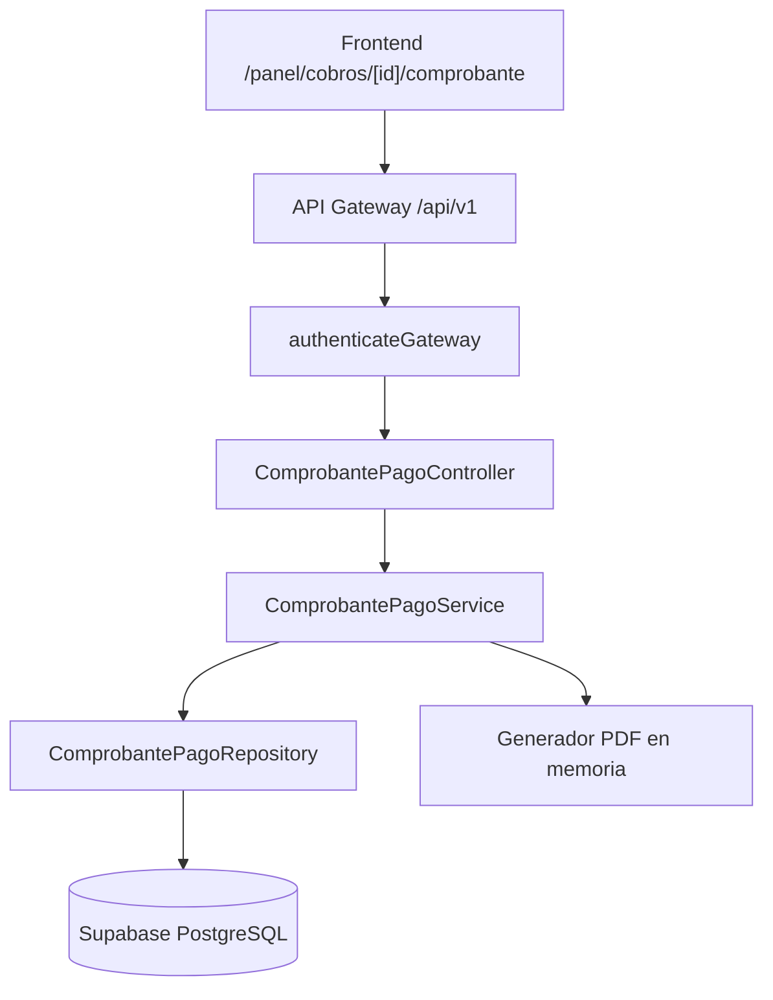

# Plan de implementación: US-10 Emitir comprobante de pago

## Objetivo y alcance

Implementar la consulta y generación bajo demanda del comprobante de pago asociado a un cobro registrado en US-08. El comprobante será visible para el locador dueño de la propiedad y para el locatario del contrato, tendrá el mismo contenido para ambos y no se almacenará como PDF en Supabase Storage.

La implementación seguirá la arquitectura actual de `apps/api`: ruta versionada, autenticación, repository, service, DTOs locales, generación de PDF y documentación OpenAPI. El frontend consumirá los datos para la vista responsive y usará el mismo endpoint para descargar/imprimir el PDF.

El comprobante solo existe después de un cobro. US-08 asigna y persiste `numero_comprobante` con formato `RC-AAAA-NNNN`, `fecha_emision` y el cobro completo. US-10 no asigna otro número ni modifica el cobro.

## 1. Reglas de negocio

### Emisión

1. No se puede consultar ni generar un comprobante para un período sin cobro.
2. Cada cobro tiene un único número `RC-AAAA-NNNN`, asignado por US-08 dentro de la transacción de registro.
3. El comprobante emitido no se modifica ni se elimina.
4. Cada consulta o descarga genera el PDF nuevamente desde los datos persistidos; no se guarda un PDF en un bucket.
5. El estado del comprobante de US-08 es `pagado`, porque esta versión no admite cobros parciales.
6. Si una futura versión incorpora pagos parciales o anulaciones, deberá ampliar el DTO y el renderizado en US-09/US-10 sin cambiar retroactivamente el documento ya emitido.

### Acceso y autorización

1. Se requiere sesión mediante `authenticateGateway`.
2. Se autoriza si el usuario autenticado es:
   - el locador de la propiedad del contrato; o
   - el locatario principal asociado al contrato.
3. Un garante, otro locador, otro locatario o un usuario sin relación deben recibir el mismo 404 y mensaje: `No encontramos este comprobante`.
4. La consulta de autorización debe filtrar por `cobro.id` y la relación permitida en la misma consulta; no se debe consultar primero el cobro y autorizar después.
5. No se deben exponer datos de otras propiedades del locador, otros contratos, solicitudes o postulantes.

### Contenido

El comprobante debe incluir:

- encabezado, logo/datos de RentAR, número, fecha y hora de emisión y estado `Pagado`;
- locatario: nombre, apellido, DNI, correo y teléfono;
- locador: nombre, apellido, DNI/CUIT si existe, correo y teléfono;
- propiedad: dirección completa, piso, barrio y ciudad;
- contrato: código, vigencia desde/hasta y período calendario `YYYY-MM`;
- período: rango de fechas y fecha de vencimiento;
- detalle de cargos:
  - alquiler base del período;
  - intereses por mora, si corresponden;
  - total pagado;
- medio y fecha del cobro;
- leyenda: `Comprobante emitido por RentAR. No válido como factura.`

Las expensas no forman parte del total cobrado por US-08 y no deben aparecer como una línea del comprobante de esta historia. Pueden mostrarse como dato informativo solo si US-09 lo requiere, claramente separado del monto pagado.

El interés se obtiene del snapshot del período y se calcula de forma lineal: `monto_base_alquiler * (interes_diario_pct / 100) * dias_con_interes`. El total debe coincidir con `cobro.monto`; si no coincide, el service debe devolver un error de consistencia y no generar un documento incorrecto.

## 2. Estado actual de Supabase

La migración de US-08 crea y persiste:

- `cobro.id`;
- `cobro.id_periodo`;
- `cobro.monto`;
- `cobro.fecha_cobro`;
- `cobro.medio`;
- `cobro.nota`;
- `cobro.numero_comprobante`;
- `cobro.fecha_emision`;
- `cobro.comprobante_storage_path`, que corresponde únicamente al archivo adjunto opcional del locador;
- `periodo_cobro`, con mes calendario, alquiler base, interés diario, días de gracia, vencimiento y estado;
- `contrato_x_usuario`, con locador y locatario;
- `inmueble`, con propiedad y locador.

El bucket `comprobantes-cobros` existe y se reserva para el adjunto original cargado en US-08. No se debe usar para el PDF generado por US-10.

No se debe agregar `pdf_storage_path` ni otra ruta de PDF al modelo de cobro. Si existe una columna con ese propósito para contratos en US-27, no debe reutilizarse: el PDF del comprobante tiene ciclo de vida bajo demanda.

## 3. Contrato HTTP propuesto

### `GET /api/v1/cobros/:id/comprobante`

Devuelve los datos completos del comprobante en JSON para que el frontend pueda mostrar la vista responsive.

Autorización:

- locador propietario de la propiedad;
- locatario principal del contrato.

Respuesta `200`:

```json
{
  "success": true,
  "data": {
    "id_cobro": 50,
    "numero_comprobante": "RC-2026-0001",
    "fecha_emision": "2026-11-03T14:00:00.000Z",
    "estado": "pagado",
    "locatario": {},
    "locador": {},
    "propiedad": {},
    "contrato": {},
    "periodo": {},
    "cargos": [],
    "total_pagado": 103000,
    "medio": "transferencia",
    "fecha_cobro": "2026-11-02"
  }
}
```

Si el cobro no existe o no pertenece al usuario autenticado:

- `404`;
- `error: "No encontramos este comprobante"`.

### `GET /api/v1/cobros/:id/comprobante/pdf`

Genera el PDF en cada request y lo devuelve como stream:

- `Content-Type: application/pdf`;
- `Content-Disposition: attachment; filename="RC-AAAA-NNNN.pdf"` para descarga;
- sin escribir el PDF en Supabase Storage;
- con la misma autorización del endpoint JSON.

El endpoint puede aceptar `?descarga=false` o un header `Accept` para decidir entre `inline` y `attachment`, pero la autorización y el contenido deben ser idénticos.

## 4. DTOs

Crear `apps/api/src/dtos/comprobante-pago.dto.ts` y exportarlo desde `apps/api/src/dtos/index.ts`.

Tipos sugeridos:

- `ComprobantePagoDTO`;
- `PersonaComprobanteDTO`;
- `PropiedadComprobanteDTO`;
- `ContratoComprobanteDTO`;
- `PeriodoComprobanteDTO`;
- `CargoComprobanteDTO`;
- `MedioCobroManualDTO` reutilizado desde US-08.

`CargoComprobanteDTO` debe distinguir:

```ts
interface CargoComprobanteDTO {
  concepto: 'alquiler' | 'intereses_mora';
  monto: number;
  diasMora?: number;
}
```

El DTO no debe incluir rutas internas de Storage, claves de servicio ni datos de otros contratos. El endpoint PDF no devuelve JSON: devuelve bytes y headers HTTP.

## 5. Arquitectura y componentes



### Repository

Crear `apps/api/src/repositories/comprobante-pago.repository.ts` con consultas por lote y autorización en la misma consulta:

- `findByIdAndUsuarioPermitido(idCobro, usuarioId)`;
- `getDatosParaComprobante(idCobro, usuarioId)`;
- `createSignedUrlForAttachedProof(...)` solo si US-09 necesita descargar el adjunto original.

La consulta debe unir:

- `cobro`;
- `periodo_cobro`;
- `contrato`;
- `inmueble` y su locador;
- `contrato_x_usuario` y su locatario.

La condición de autorización debe ser equivalente a:

```sql
inmueble.id_locador = :usuario
OR EXISTS (
  SELECT 1
  FROM contrato_x_usuario
  WHERE id_contrato = contrato.id
    AND id_usuario = :usuario
    AND tipo_firmante = 2
)
```

Las consultas de garantes u otros participantes solo deben traer datos del contrato del cobro. No se necesitan para el contenido mínimo actual, salvo que se acuerde agregarlos.

### Service

Crear `apps/api/src/services/comprobante-pago.service.ts`:

1. Solicita el cobro autorizado al repository.
2. Si no existe coincidencia, devuelve un error 404 genérico.
3. Calcula el desglose de intereses usando los snapshots del período.
4. Verifica que `alquiler + intereses = cobro.monto` dentro de la precisión monetaria definida.
5. Construye `ComprobantePagoDTO`.
6. Para PDF, pasa el DTO a un generador determinista y devuelve un `Buffer`.
7. No modifica la base ni crea archivos persistentes durante la consulta.

### Generación PDF

Usar una biblioteca compatible con Node.js/Vercel, por ejemplo `pdf-lib`, y generar el documento en memoria con tamaño A4. El generador debe:

- usar fuentes y logo disponibles en `apps/api` o un recurso empaquetado;
- convertir el total a letras mediante una utilidad testeada;
- controlar saltos de página y textos largos;
- no depender de una URL pública del comprobante;
- devolver el mismo contenido que la vista JSON.

La vista web debe reutilizar `ComprobantePagoDTO` para mostrar el comprobante en móvil y escritorio. La impresión A4 puede apoyarse en CSS de impresión; la descarga usa el endpoint PDF.

## 6. Rutas y OpenAPI

Crear `apps/api/src/controllers/comprobante-pago.controller.ts` y `apps/api/src/routes/v1/comprobantes.routes.ts`. Montar el router en `apps/api/src/routes/v1/index.ts` como `/comprobantes` o `/cobros`, manteniendo una sola convención.

Recomendación de rutas:

- `GET /api/v1/cobros/:id/comprobante`;
- `GET /api/v1/cobros/:id/comprobante/pdf`.

Documentar con seguridad `SupabaseBearerAuth`, no `bearerAuth`, y describir:

- `200` JSON para la ficha;
- `200` PDF para descarga;
- `401` sin sesión;
- `404` tanto para inexistente como para ajeno;
- `500` si el documento no puede generarse.

## 7. Frontend

Agregar `apps/web/src/services/comprobantes.service.ts` para:

- consultar los datos JSON;
- abrir/descargar el PDF desde la URL autorizada;
- manejar el 404 genérico;
- conservar el token de Supabase mediante el cliente HTTP existente cuando el endpoint PDF se consuma con `fetch`.

Crear la vista de `/panel/cobros/[id]/comprobante` con:

- versión responsive tipo tarjeta;
- botón de imprimir;
- botón de descargar PDF;
- `@media print` para ocultar menú, filtros y acciones;
- nombre de archivo basado en `numero_comprobante`.

La pantalla de US-09 debe enlazar a esta ruta para el locador y el locatario.

## 8. Pruebas unitarias

Agregar pruebas con repository falso y generador PDF aislado:

- cobro inexistente: 404;
- cobro de otra propiedad: 404;
- cobro de otro locatario: 404;
- acceso del locador propietario: permitido;
- acceso del locatario principal: permitido;
- garante u otro usuario: 404;
- dos comprobantes consecutivos conservan sus números;
- número con formato `RC-AAAA-NNNN`;
- comprobante sin cobro: imposible/no encontrado;
- contenido con alquiler base e intereses separados;
- expensas no incluidas en el total;
- cálculo lineal de mora consistente con US-08;
- total persistido distinto del desglose: error de consistencia;
- PDF generado sin escribir en Storage;
- PDF con tamaño A4, nombre correcto y headers correctos;
- total en números y letras;
- datos largos no se superponen ni se pierden al cambiar de página;
- vista JSON y PDF representan los mismos datos;
- contrato sin mora: no muestra línea de intereses.

## 9. Archivos previstos

- `apps/api/src/dtos/comprobante-pago.dto.ts` y `apps/api/src/dtos/index.ts`;
- `apps/api/src/repositories/comprobante-pago.repository.ts`;
- `apps/api/src/services/comprobante-pago.service.ts`;
- `apps/api/src/controllers/comprobante-pago.controller.ts`;
- `apps/api/src/routes/v1/comprobantes.routes.ts` y `apps/api/src/routes/v1/index.ts`;
- `apps/api/src/pdf/comprobante-pago.pdf.ts` o equivalente;
- dependencia de generación PDF compatible con Node.js/Vercel;
- `apps/api/tests/unit/comprobante-pago.service.unit.test.ts`;
- `apps/api/tests/unit/comprobante-pago.pdf.unit.test.ts`;
- `apps/web/src/services/comprobantes.service.ts`;
- pantalla `/panel/cobros/[id]/comprobante` y estilos de impresión;
- `docs/api-endpoints.md` y `docs/HANDOFF-BACKEND.md`.

No se debe agregar un bucket ni una columna para almacenar el PDF. El bucket `comprobantes-cobros` solo contiene los adjuntos originales de US-08.

## 10. Secuencia de implementación

1. Verificar que la migración de US-08 esté aplicada y que `cobro.numero_comprobante` y `fecha_emision` existan.
2. Implementar repository con autorización simultánea para locador propietario o locatario principal.
3. Definir DTO JSON y la transformación de datos del cobro, período, contrato, propiedad y participantes.
4. Implementar el service y la validación del desglose contra el monto persistido.
5. Implementar el generador PDF en memoria y la conversión de montos a letras.
6. Crear controller, rutas JSON/PDF y Swagger.
7. Agregar pruebas unitarias de autorización, contenido y generación sin Storage.
8. Implementar la vista responsive, impresión y descarga en el frontend.
9. Integrar los accesos desde US-09 y validar locador/locatario con el mismo comprobante.
10. Validar manualmente pantalla, PDF descargado, impresión A4, móvil y accesos cruzados.

## 11. Criterio de cierre

US-10 queda lista cuando:

- el comprobante solo existe asociado a un cobro;
- locador y locatario ven el mismo contenido;
- usuarios no autorizados reciben el 404 genérico;
- cada número es correlativo anual, único y no reutilizable;
- el PDF se genera bajo demanda y nunca se persiste en un bucket;
- el adjunto original de US-08 se mantiene separado del PDF emitido;
- alquiler e intereses aparecen como líneas separadas y las expensas no se suman;
- JSON, vista web, impresión y PDF contienen la misma información;
- las pruebas unitarias cubren autorización, datos, mora y generación de archivo.
